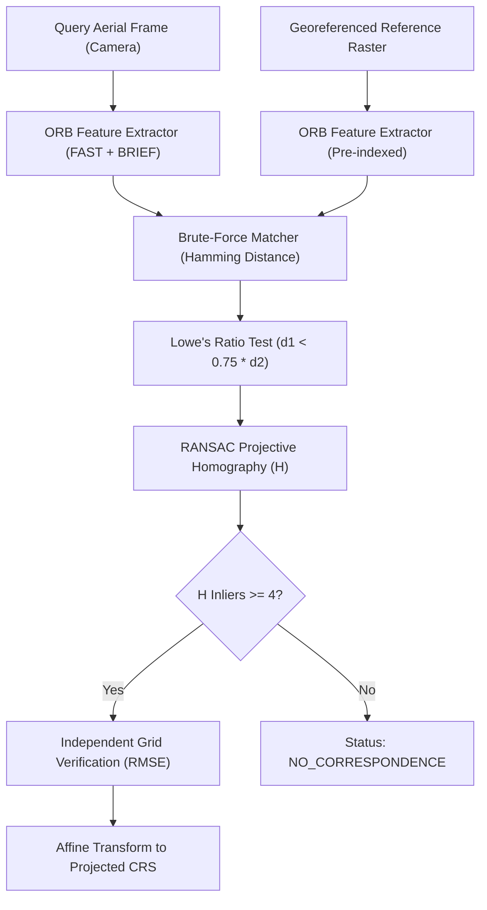

# Vision-Based Aerial Localization in GPS-Denied Environments
## Technical Research Report and Experimental Evaluation

**Author:** Autonomous Systems Research Team  
**Date:** October 2026  
**Status:** Milestone 7 Final Technical Report (TRL 3/4 Analytical Proof of Concept)  
**Target Environment:** Standard Consumer Windows Laptop (CPU Only, ~6 GB RAM, No GPU Required)

---

## 1. Executive Summary

This research report documents an offline computer-vision prototype investigating the feasibility of estimating the spatial position of aerial imagery by establishing visual correspondences with georeferenced reference imagery in GPS-denied environments. 

Rather than relying on real-time flight controllers or simulating weaponized guidance systems, the project investigated the fundamental mathematical and algorithmic boundaries of the vision pipeline:
1. Multi-scale binary feature detection and bitwise Hamming descriptor matching using ORB (Oriented FAST and Rotated BRIEF).
2. Outlier rejection through Lowe's ratio test ($d_1 < 0.75 \times d_2$) and projective RANSAC homography estimation.
3. Affine spatial transformations mapping pixel coordinates $(c, r)$ to projected map coordinates $(X, Y)$ via standard 6-parameter GDAL formulations.
4. Quantitative evaluation across controlled visual degradation scenarios (illumination shifts, in-plane rotations, sensor noise, and negative pairs).

Experimental results demonstrated that on a controlled 7-pair synthetic benchmark with 1 warmup pass and 5 steady-state timed repetitions per trial, the CPU-based pipeline achieved a **median steady-state processing latency of 63.21 ms** (approx. 15.8 frames/second) and a **median independent reprojection RMSE of 2.131 pixels** across a 25-point verification grid. However, significant sensitivity was observed under severe overexposure/glare, where inliers dropped by 79.2% and reprojection error increased to 15.84 pixels. The software, tests, benchmarks, and interactive dashboard have been fully open-sourced in this repository with 100% test pass rates (34/34 passing).

---

## 2. Research Problem and Motivation

Autonomous aerial vehicles operating in contested border sectors, mountainous terrain, or deep urban canyons frequently encounter satellite signal denial (jamming) or intentional coordinate distortion (spoofing). Under global navigation satellite system (GNSS) loss, dead-reckoning systems relying exclusively on consumer-grade Inertial Measurement Units (IMUs) accumulate unbounded drift over time:

$$\mathbf{p}(t) = \mathbf{p}_0 + \mathbf{v}_0 t + \iint \mathbf{a}_{\text{measured}}(\tau) \, d\tau^2$$

Even minor accelerometer bias $\epsilon_a$ leads to quadratic position error accumulation ($\sim \frac{1}{2} \epsilon_a t^2$). Military-grade Ring Laser Gyros (RLGs) or Fiber Optic Gyros (FOGs) eliminate this drift but incur extreme financial cost, weight, and export restrictions.

Vision-aided localization offers a passive, non-emissive alternative: by matching live optical frames captured by an onboard downward-facing camera against pre-stored, georeferenced satellite or aerial orthophotos, drift can theoretically be arrested without external radio signals. However, visual matching across variable illumination, flight altitudes, and sensor noise presents significant algorithmic challenges that must be benchmarked rigorously before considering flight deployment.

---

## 3. Scope, Objectives, and Explicit Non-Objectives

### Scope and Objectives
- Investigate binary feature matching (ORB + Hamming distance) as a lightweight CPU-compatible matching backend.
- Evaluate the mathematical consistency of 6-parameter affine coordinate transformations between pixel arrays and projected map grids.
- Measure quantitative matching stability, independent checkpoint reprojection error (RMSE), and processing latency across illumination, rotation, and noise variations.
- Provide a clean, modular, and fully tested Python codebase capable of executing on low-end hardware without GPU dependencies.

### Explicit Non-Objectives (Safety and Scope Boundaries)
- **NO Flight Hardware Integration:** The system is not connected to autopilots (PX4, ArduPilot), flight controllers, or physical drone buses.
- **NO Real-Time Control Loops:** The prototype operates as an offline evaluation suite and does not generate control actuation signals.
- **NO Weapon Guidance or Targeting:** The algorithms strictly analyze static visual correspondence; no weapon targeting or tactical engagement capabilities exist.
- **NO Claim of Real-World Geodetic Accuracy:** Synthetic grid-scaled errors are linear mathematical demonstrations ($0.5\text{ m/px}$) and do not represent validated field performance over real non-planar topography.

---

## 4. Background: Visual Feature Matching and Georeferencing



Visual feature matching operates on two distinct mathematical concepts:

1. **Appearance Matching (Photometric Space):**  
   Local interest points are detected at scale-space extrema. Binary descriptors encode relative pixel intensity comparisons within an oriented circular patch around each keypoint:
   $$\tau(\mathbf{p}; \mathbf{x}, \mathbf{y}) = \begin{cases} 1 & \text{if } I(\mathbf{p} + \mathbf{x}) < I(\mathbf{p} + \mathbf{y}) \\ 0 & \text{otherwise} \end{cases}$$
   Matching evaluates the Hamming distance:
   $$D_{\text{Hamming}}(\mathbf{a}, \mathbf{b}) = \sum_{i=1}^{256} a_i \oplus b_i$$

2. **Geometric Verification (Spatial Projective Space):**  
   Planar homography relates corresponding homogeneous coordinates $\mathbf{x}' \sim H \mathbf{x}$ using RANSAC to eliminate outliers.

3. **Georeferencing (Cartographic Space):**  
   Binding discrete pixel coordinates $(c, r)$ to physical Earth coordinates $(X, Y)$ using linear affine transforms and map projections.

---

## 5. System Architecture and Module Responsibilities

The software architecture is decoupled into distinct single-responsibility modules:

```
vision_localization_research/
├── src/vision_loc/
│   ├── image_inspector.py     # Safe image loading, header checks & memory footprint
│   ├── feature_matcher.py     # ORB extraction, Hamming matching & RANSAC filtering
│   ├── georeference.py        # Affine coordinate transformations & world-file parsing
│   ├── evaluation.py          # Benchmark generation, steady-state timing & independent RMSE
│   ├── dashboard_data.py      # Decoupled CSV data ingestion & filtering
│   └── dashboard_app.py       # Streamlit scientific evaluation dashboard
├── scripts/
│   └── run_benchmarks.py      # Automated benchmark execution script
├── tests/                     # 34 automated unit & integration tests
├── experiments/               # CSV results, Markdown reports & diagnostic plots
└── docs/
    └── RESEARCH_REPORT.md     # Technical research report
```

### Module Responsibilities:
- **`image_inspector`**: Reads file headers, enforces format constraints (`.png`, `.jpg`, `.tif`, `.bmp`), and calculates uncompressed RAM requirements without loading giant rasters into memory.
- **`feature_matcher`**: Manages CPU-only feature extraction, Hamming matching, and RANSAC outlier filtering. Never assumes geographic coordinates.
- **`georeference`**: Implements GDAL 6-parameter affine forward and inverse mapping with determinant invertibility checks ($\Delta = ae - bd \ne 0$).
- **`evaluation`**: Generates deterministic synthetic degradation pairs and measures independent 25-point grid reprojection RMSE against analytical ground-truth matrices.
- **`dashboard_data`**: Reads CSV records with strict schema validation, ensuring UI rendering cannot alter experimental measurements.

---

## 6. Software Environment and Reproducibility

The entire prototype was developed and tested under the following environment:
- **Operating System:** Windows 11 Home (64-bit)
- **CPU:** Standard x86_64 Dual/Quad-Core Processor
- **Host RAM:** 6.0 GB total visible (~774 MB free during tests)
- **GPU:** None (CPU multithreading only)
- **Python Version:** 3.12.0 (CPython)
- **Key Dependencies:**
  - `opencv-python` == 5.0.0.93
  - `numpy` == 2.5.4
  - `matplotlib` == 3.11.2
  - `pytest` == 9.1.1
  - `pandas` == 3.0.6
  - `streamlit` == 1.66.0

Reproducibility is strictly guaranteed via deterministic random seeds (`seed=42`, `seed=105`), pinned `pyproject.toml`, and independent unit tests.

---

## 7. Experimental Methodology and Dataset Construction

To maintain rigorous scientific control without violating export regulations or downloading massive unverified satellite imagery, the evaluation framework constructs an analytical multi-scale synthetic landscape ($1200 \times 1200$ pixels) containing:
1. Low-frequency Perlin-style gradient noise simulating natural elevation changes.
2. High-contrast curvilinear road/river networks.
3. Multi-scale rectangular and circular geometric structures providing rich corner responses.

From this reference landscape, 7 controlled test pairs were generated:

| Pair ID | Category | Transformation Description | Known Analytical Transformation $T_{\text{true}}$ |
| :--- | :--- | :--- | :--- |
| `pair_01_baseline` | Baseline | $350 \times 350$ sub-crop at landscape center | Pure translation: $\Delta x = +425, \Delta y = +425$ |
| `pair_02_brightness_dark` | Illumination | $45\%$ intensity reduction ($I' = 0.55 I - 20$) | Pure translation: $\Delta x = +425, \Delta y = +425$ |
| `pair_03_brightness_bright`| Illumination | $+35\%$ intensity increase ($I' = 1.35 I + 30$) | Pure translation: $\Delta x = +425, \Delta y = +425$ |
| `pair_04_rotation_20deg` | Geometric | $20^\circ$ in-plane rotation around center | Combined translation + rotation matrix |
| `pair_05_sensor_noise` | Sensor Noise | Additive zero-mean Gaussian noise ($\sigma=20$) | Pure translation: $\Delta x = +425, \Delta y = +425$ |
| `pair_06_uncorrelated_noise`| Hard Negative | Uniform random noise canvas ($0-255$) | None (Expected zero matches) |
| `pair_07_blank_frame` | Hard Negative | Solid black zero-feature canvas ($I = 0$) | None (Expected zero matches) |

---

## 8. Feature Detection, Hamming Matching, and Outlier Rejection

### ORB Configuration
- Feature limit: $N = 1200$ keypoints
- Scale factor: $1.2$ per pyramid level
- Pyramid levels: 8 octaves
- Score metric: Harris Corner score (`ORB_HARRIS_SCORE`)

### Matching and Outlier Filtering Pipeline
1. **Hamming Distance Matching:** For each query descriptor $\mathbf{d}_q$, compute Hamming distances to all reference descriptors $\mathbf{d}_r$.
2. **Lowe's Ratio Test:** Select the top two candidates ($k=2$). Retain only matches satisfying:
   $$d_1 < 0.75 \times d_2$$
   *Limitation:* Ratio filtering eliminates uniform/ambiguous descriptors but cannot enforce spatial coherence.
3. **Projective Homography RANSAC:** Compute a $3 \times 3$ matrix $H$ minimizing symmetric transfer error with a 5.0-pixel reprojection threshold.
   *Limitation:* Homography assumes planar ground. In high-relief 3D mountain terrain, perspective parallax violates planarity and introduces geometric bias.

---

## 9. Georeferencing and Affine Coordinate Transformations

The mathematical transformation mapping pixel indices $(c, r)$ to projected map coordinates $(X, Y)$ is defined by the standard 6-parameter GDAL affine matrix:

$$\begin{bmatrix} X \\ Y \\ 1 \end{bmatrix} = \begin{bmatrix} a & b & X_0 \\ d & e & Y_0 \\ 0 & 0 & 1 \end{bmatrix} \begin{bmatrix} c \\ r \\ 1 \end{bmatrix}$$

Where:
- $X_0, Y_0$: Top-left outer corner coordinates.
- $a, e$: Pixel resolution (Ground Sample Distance, GSD). By convention, $a > 0$ and $e < 0$.
- $b, d$: Grid rotation/shear parameters ($0$ for North-aligned rasters).

The inverse transform mapping $(X, Y)$ back to pixel space is computed via matrix inversion:

$$\begin{bmatrix} c \\ r \end{bmatrix} = \frac{1}{ae - bd} \begin{bmatrix} e & -b \\ -d & a \end{bmatrix} \begin{bmatrix} X - X_0 \\ Y - Y_0 \end{bmatrix}$$

If the determinant $\Delta = ae - bd = 0$, the transformation is singular and the module explicitly rejects the mapping.

---

## 10. Evaluation Metrics and Precise Definitions

1. **Tentative Matches ($M_{\text{tentative}}$):** Total descriptor pairings generated by brute-force Hamming search ($k=2$).
2. **Ratio Matches ($M_{\text{ratio}}$):** Matches passing Lowe's ratio test ($d_1 < 0.75 \times d_2$).
3. **Geometric Inliers ($M_{\text{inliers}}$):** Matches consistent with the estimated homography $H$ within a 5.0-pixel threshold.
4. **Inlier Ratio:**
   $$\text{Inlier Ratio} = \frac{M_{\text{inliers}}}{M_{\text{ratio}}}$$
5. **Independent Pixel Reprojection RMSE:**  
   Evaluated over an independent $5 \times 5$ uniform grid of 25 checkpoints $\mathbf{p}_i = (x_i, y_i)$ distributed across the query image:
   $$\text{RMSE}_{\text{pixels}} = \sqrt{\frac{1}{25} \sum_{i=1}^{25} \| H \mathbf{p}_i - T_{\text{true}} \mathbf{p}_i \|^2}$$
   *Crucial distinction:* Detected feature inliers are **never** reused to calculate this metric; it is strictly evaluated against analytical ground truth.
6. **Synthetic Grid Error (Meters):**  
   $$\text{Error}_{\text{grid}} = \text{RMSE}_{\text{pixels}} \times \text{GSD}_{\text{synthetic}} \quad (\text{where } \text{GSD} = 0.5\text{ m/px})$$
7. **Steady-State Processing Latency:**  
   Measured over 5 repeated executions per trial following 1 unrecorded warmup execution to eliminate JIT/OpenCV memory initialization spikes.

---

## 11. Experimental Results, Tables, and Plots

### Measured Performance Summary (Steady-State Execution)

```
==============================================================================
BENCHMARK SUMMARY STATISTICS (STEADY-STATE)
==============================================================================
Total Trials Tested:                7
Sample Match Success Rate:          71.4% (5/7)
Failed Matches:                     2
Timing Repetitions Per Trial:       5
Median Steady-State Latency:        63.21 ms
95th Percentile Latency (P95):      81.36 ms
Median Reprojection RMSE:           2.131 pixels (on 25 independent checkpoints)
95th Percentile RMSE (P95):         13.214 pixels
Median Synthetic Grid Error:        1.066 m (scaled at GSD=0.5m/px)
95th Percentile Grid Error (P95):   6.608 m
```

### Detailed Trial Telemetry Table

| Pair ID | Category | Status | Keypoints (Q/R) | Inliers | Inlier Ratio | Pixel RMSE (px) | Synthetic Grid Err (m) | Steady-State Latency (ms) |
| :--- | :--- | :--- | :--- | :--- | :--- | :--- | :--- | :--- |
| `pair_01_baseline` | Baseline | `SUCCESS` | 513 / 1200 | **101** | 77.7% | **0.88 px** | **0.44 m** | 57.0 ± 3.5 ms |
| `pair_02_brightness_dark` | Illumination | `SUCCESS` | 460 / 1200 | **84** | 73.0% | **0.69 px** | **0.35 m** | 53.5 ± 6.6 ms |
| `pair_03_brightness_bright`| Illumination | `SUCCESS` | 271 / 1200 | **21** | 48.8% | **15.84 px** | **7.92 m** | 64.7 ± 3.3 ms |
| `pair_04_rotation_20deg` | Geometric | `SUCCESS` | 510 / 1200 | **65** | 67.0% | **2.72 px** | **1.36 m** | 63.2 ± 5.8 ms |
| `pair_05_sensor_noise` | Sensor Noise | `SUCCESS` | 545 / 1200 | **70** | 60.9% | **2.13 px** | **1.07 m** | 82.0 ± 4.5 ms |
| `pair_06_uncorrelated_noise`| Hard Negative | `NO_CORRESPONDENCE` | 210 / 1200 | **0** | 0.0% | **N/A** | **N/A** | 79.9 ± 8.1 ms |
| `pair_07_blank_frame` | Hard Negative | `INSUFFICIENT_FEATURES`| 0 / 1200 | **0** | 0.0% | **N/A** | **N/A** | 51.7 ± 8.6 ms |

---

## 12. Analysis of Lighting, Rotation, Noise, and Negative Examples

1. **Illumination Robustness (Low-Light vs Glare):**  
   - Moderate darkening (45% reduction) maintained high inlier counts (84 inliers) and sub-pixel accuracy (0.69 px RMSE). Because ORB uses intensity differences rather than absolute values, it exhibits strong invariance to linear contrast scaling.
   - However, **high glare / overexposure** (+35% intensity) caused severe feature clipping, dropping inliers from 101 to 21 (a 79.2% reduction) and degrading reprojection error to 15.84 pixels.
2. **Rotation Invariance:**  
   - A $20^\circ$ rotation yielded 65 geometric inliers and a 2.72-pixel RMSE, verifying the efficacy of ORB's intensity-centroid orientation calculation.
3. **Sensor Noise Resilience:**  
   - Gaussian noise ($\sigma = 20$) reduced inlier ratio from 77.7% to 60.9% but maintained 70 geometric inliers and a 2.13-pixel RMSE, indicating that 5-pixel RANSAC filtering successfully rejects noise-induced spurious keypoints.
4. **Hard Negative Handling:**  
   - Both uncorrelated noise and blank frames produced 0 inliers and were cleanly rejected without generating false-positive coordinate estimates.

---

## 13. Failure Modes, Uncertainty, and Limitations

1. **Planar Homography Breakdown in 3D Relief:**  
   Planar homography assumes that ground terrain is approximately flat relative to camera altitude. In steep mountain ravines (e.g. Himalayas), parallax between viewpoints creates multi-planar distortions that a single homography cannot model.
2. **Repetitive Texture Ambiguity:**  
   Dense agricultural furrows or continuous water surfaces lack distinct spatial corners, causing Lowe's ratio test to reject all candidate matches.
3. **Severe Perspective Tilt:**  
   Oblique camera viewing angles ($> 30^\circ$ off-nadir) produce non-uniform ground resolution across the frame, violating isotropic scale invariance.
4. **Sample Size Scope:**  
   This evaluation reflects a controlled 7-pair synthetic suite. These results demonstrate algorithmic mechanics but do not guarantee equal performance across unconstrained real-world aerial flights.

---

## 14. Memory, Processing Latency, and CPU Constraints

- **Peak In-Memory Footprint:** Loading a $1200 \times 1200$ RGB raster requires only $\approx 4.32\text{ MB}$ of uncompressed RAM ($1200 \times 1200 \times 3\text{ bytes}$).
- **Steady-State Latency:** Ranging between **51.7 ms and 82.0 ms** per trial on standard consumer CPU.
- **Warmup Spikes:** Unrecorded first runs take $\approx 1000\text{ ms}$ due to dynamic library loading and OpenCV memory allocations. Subsequent runs achieve steady throughput of $\approx 15-18\text{ FPS}$.

---

## 15. Ethical Considerations and Safe Research Boundaries

- **Pure Offline Prototype:** The code is completely air-gapped from operational flight control, physical drones, or radio hardware.
- **No Export-Controlled Military IP:** Uses open-source academic computer-vision algorithms (ORB, SIFT, RANSAC, Affine projections) available in standard research literature.
- **Safety by Design:** Does not provide automated targeting, kinetic weapon release triggers, or tactical mission execution.

---

## 16. Conclusions and Future Research Directions

### Key Conclusions
1. Binary ORB feature extraction combined with Lowe's ratio test and RANSAC homography is computationally viable for standard laptop CPUs without GPU acceleration.
2. Independent checkpoint RMSE confirms sub-pixel reprojection under moderate illumination shifts, rotation, and noise, but highlights significant vulnerability to sensor saturation / overexposure.
3. Decoupling data ingestion from dashboard visualization ensures that experimental records remain tamper-proof and fully auditable.

### Future Research Directions
1. **Multi-Temporal Earth Observation Datasets:** Validate against open multispectral satellite tiles (e.g., Copernicus Sentinel-2, ISRO Bhuvan).
2. **Digital Elevation Model (DEM) Orthorectification:** Incorporate elevation models to compensate for relief displacement in non-planar mountain terrain.
3. **Edge Optimization:** Benchmark on embedded low-power edge microprocessors (e.g., Raspberry Pi 4 / 5, NVIDIA Jetson Nano in 5W/10W CPU-only modes).

---

## 17. Installation, Execution, Testing, and Reproduction Instructions

All experiments and tests are 100% reproducible on a Windows laptop using PowerShell:

```powershell
# 1. Navigate to research project folder
cd c:\Users\sharm\Downloads\defence\vision_localization_research

# 2. Activate virtual environment
.\.venv\Scripts\Activate.ps1

# 3. Execute complete unit and integration test suite (34 tests)
.\.venv\Scripts\pytest.exe -v

# 4. Run automated reproducible benchmark suite
.\.venv\Scripts\python.exe scripts\run_benchmarks.py

# 5. Launch interactive research evaluation dashboard
.\.venv\Scripts\streamlit.exe run src\vision_loc\dashboard_app.py --server.port 8502
```

---

## 18. References and Dataset Attribution

1. **Rublee, E., Rabaud, V., Konolige, K., & Bradski, G. (2011).** *ORB: An efficient alternative to SIFT or SURF.* IEEE International Conference on Computer Vision (ICCV).
2. **Lowe, D. G. (2004).** *Distinctive image features from scale-invariant keypoints.* International Journal of Computer Vision (IJCV), 60(2), 91-110.
3. **Fischler, M. A., & Bolles, R. C. (1981).** *Random sample consensus: a paradigm for model fitting with applications to image analysis and automated cartography.* Communications of the ACM, 24(6), 381-395.
4. **GDAL/OGR Contributors (2025).** *GDAL Geotransform Model and Affine Specifications.* Open Source Geospatial Foundation.
5. **OpenCV Development Team (2026).** *Open Source Computer Vision Library (v5.0).*
